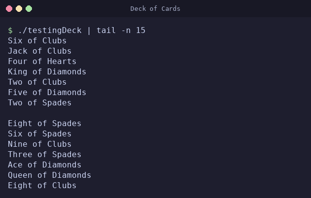

# Deck-of-Cards
Represents a 52-card deck with C++. Allows for creation of empty decks and movement. Has some other functionality as well.



*The last 15 lines printed by `testing/testingDeck.cc`: the two seven-card hands it deals from a shuffled deck.*

## API overview

Include `Card.h` and/or `Deck.h` from `src/` and link against `src/Card.cc` and `src/Deck.cc` (the CMake build below packages these as the `deck_of_cards` library).

### `Card` (`src/Card.h`)

A single card: a rank from 1 (Ace) to 13 (King) plus a suit string.

- `Card(int rank, std::string suit)` / `Card(int rank, const char *suit)` — throws `std::runtime_error` if `rank` is not between 1 and 13, and the `const char *` overload throws `std::invalid_argument` if `suit` is null. The suit is otherwise stored as given; it is not validated.
- `getRank()` — the rank, 1–13.
- `getSuit()` — the suit string passed to the constructor.
- `getName()` — the card's name, e.g. `"Ace of Hearts"`, `"Seven of Clubs"`, `"Queen of Spades"`.
- `operator==` — true when rank, suit, and name all match.
- `operator<` — compares **rank only**; suit is ignored.
- `operator<<(std::ostream&, const Card&)` — writes the card's name.

### `Deck` (`src/Deck.h`)

A named, ordered collection of `Card`s.

- `Deck(bool empty, const char *name)` — creates an empty deck when `empty` is `true`; otherwise calls `generate()` to fill it with the 52 standard cards. Throws `std::invalid_argument` if `name` is null.
- `generate()` — appends the 52 standard cards (Hearts, Spades, Diamonds, Clubs; Ace through King within each suit). Existing cards are not removed first, so calling it on a non-empty deck adds to what is already there.
- `shuffle()` — shuffles the cards randomly (`std::shuffle` with a `std::mt19937` seeded from `std::random_device`).
- `sortInOrder()` — sorts by rank using `Card::operator<`; the relative order of equal-rank cards of different suits is unspecified. Sorting keeps every card exactly once. On an empty or one-card deck, `shuffle()` and `sortInOrder()` leave the deck as it is.
- `moveTo(Deck &dest, int index)` — removes the card at `index` from this deck and appends it to the end of `dest`. When `dest` is this same deck, the card moves to the end of it and the size is unchanged. Throws `std::out_of_range` if `index` is not a valid position.
- `getCard(int index)` — returns a copy of the card at `index`. Throws `std::out_of_range` if `index` is not a valid position.
- `contains(int rank)` — returns the **index** of the first card with that rank, or `-1` if there is none (not a `bool`).
- `howMany(int rank)` — the number of cards with that rank; `0` for a rank outside 1–13 (it does not throw).
- `size()` — the number of cards.
- `empty()` — `true` when the deck holds no cards.
- `getName()` — the name passed to the constructor.
- `print()` — writes each card's name to `std::cout`, one per line.
- `operator<<(std::ostream&, const Deck&)` — writes each card's name, separated by newlines (no trailing newline).
- Logging — `Deck` has an internal debug logger (`src/helper/mylogger.h`) that every `Deck` turns off in its constructor, so a `Deck` writes to `std::cout` only when asked to: through `print()`, or `operator<<` given `std::cout`.
- Copying — `Deck` uses the compiler-generated copy constructor and copy assignment. A copy gets its own cards and the same name, so moving cards out of one deck does not change the other.

`testing/testingDeck.cc` shows these calls together: it builds a full deck, shuffles it, and deals seven cards each to two empty decks with `myDeck.moveTo(playerone, 0)` and `myDeck.moveTo(playertwo, 0)`.

## Building and Testing

This project uses CMake as its build system and Catch2 for unit testing. Continuous Integration (CI) automatically runs the test suite on Ubuntu, macOS, and Windows for both Debug and Release builds.

### Prerequisites
- C++17 compatible compiler
- CMake 3.14 or higher
- Network access the first time you configure, unless Catch2 v3 is already installed: CMake downloads Catch2 v3.4.0 from GitHub when `find_package(Catch2 3)` finds no installed copy

### Building
```bash
mkdir build
cd build
cmake ..
cmake --build .
```

The project's own targets build with `-Wall -Wextra` (GCC and Clang) or `/W4` (MSVC). Warnings are reported but do not fail the build. The downloaded Catch2 sources keep their default warning settings.

### Running Tests
```bash
# Run all tests (both unit test suites, plus the two original test programs as smoke tests)
ctest

# Run individual test suites
./test_card    # Card class tests
./test_deck    # Deck class tests
```

### Running Original Test Programs
```bash
./testCard     # Original Card testing program
./testingDeck  # Original Deck testing program
```

### Multi-configuration generators (Visual Studio, Xcode)

The commands above assume a single-configuration generator such as Unix Makefiles or Ninja, the default on Linux and macOS. On Windows, CMake defaults to a Visual Studio generator, which keeps several configurations in one build directory. With it, name the configuration when building and testing, and run the programs from the configuration's subdirectory:

```bash
cmake --build . --config Debug
ctest -C Debug
./Debug/test_card
./Debug/testCard
```

Use `Release` in place of `Debug` for a release build. CI passes `--config` and `-C` on every platform, and its Windows legs build with the Visual Studio generator.

### Continuous Integration

The project includes a GitHub Actions CI pipeline that automatically:
- Builds the project on Ubuntu, macOS, and Windows
- Runs all unit tests in both Debug and Release configurations
- Runs the original test programs: `testCard` must print its final `Ace of Hearts (rank 1)` line, and `testingDeck` must exit successfully
- Provides immediate feedback on pull requests and commits

The project includes comprehensive unit tests covering:
- Card construction, operators, and methods
- Deck operations, shuffling, card management, and index validation
- Error handling and edge cases

## How the screenshot was captured

`docs/images/deck-of-cards.png` was captured on 2026-10-18 from a real run of the `testingDeck` program built with the CMake steps above, piped through `tail -n 15` as the image shows. The program's output was rendered to an image with [pyte](https://github.com/selectel/pyte) and [Pillow](https://python-pillow.org/). Nothing in the output was edited; only the window frame was added.
